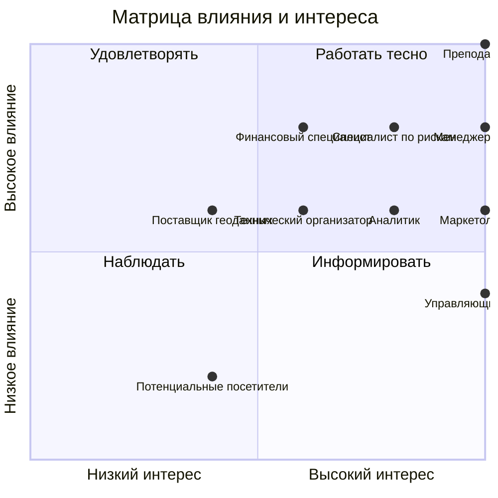

# Стейкхолдеры, матрица влияния и интереса, RACI

<!-- TODO: шаг 4 задания ЛР 1. Минимум 8 стейкхолдеров и 8 работ в RACI. -->

## Реестр стейкхолдеров

| Стейкхолдер | Роль | Что ожидает | Влияние (1–5) | Интерес (1–5) | Как работаем |
|---|---|---|---|---|---|
| Преподаватель | Заказчик и спонсор учебного проекта | Выполнение требований задания, качественный результат и соблюдение сроков | 5 | 5 | Консультации, согласование требований, защита результатов |
| Менеджер проекта | Руководство командой | Выполнение проекта в срок | 4 | 5 | Еженедельное планирование и контроль |
| Аналитик | Анализ данных и требований | Качественные данные и воспроизводимые расчёты | 3 | 4 | Совместный анализ, проверка результатов |
| Технический организатор | Архитектура и техническая реализация | Работоспособный продукт | 3 | 3 | Технические встречи, GitHub |
| Специалист по рискам | Управление рисками | Своевременное выявление и снижение рисков | 4 | 4 | Реестр рисков, еженедельный контроль |
| Маркетолог сети | Эксперт по целевой аудитории | Соответствие локации целевой аудитории | 3 | 5 | Консультации, согласование критериев |
| Финансовый специалист | Оценка экономической привлекательности | Данные для оценки коммерческой целесообразности | 4 | 3 | Консультации по затратам и ограничениям |
| Управляющие кофеен | Потенциальные пользователи | Понятный и удобный инструмент | 2 | 5 | Демонстрации, сбор обратной связи |
| Поставщик геоданных | Внешний источник данных | Корректное использование предоставленных данных | 3 | 2 | Технические запросы, проверка условий использования |
| Потенциальные посетители | Косвенно заинтересованная группа | Удобное расположение новой кофейни | 1 | 2 | Учёт потребительских характеристик при анализе |

## Матрица влияния и интереса

Ось X — интерес, ось Y — влияние. Оценки нормализованы по пятибалльной шкале:

$$
x=\frac{\text{Интерес}}{5},\qquad
y=\frac{\text{Влияние}}{5}
$$

## RACI

**Обозначения:**
- **R (Responsible)** — исполнитель работы.
- **A (Accountable)** — ответственный за результат.
- **C (Consulted)** — консультирует.
- **I (Informed)** — информируется.

| Работа | Менеджер проекта | Аналитик | Тех. организатор | Спец. по рискам | Преподаватель |
|---|---|---|---|---|---|
| Интервью с заказчиком | A | R | I | I | C |
| Подготовка устава проекта | A | R | C | C | C |
| Сбор геоданных | A | R | R | C | I |
| Анализ трафика и конкурентов | A | R | C | C | C |
| Разработка критериев оценки локаций | A | R | C | C | C |
| Формирование реестра рисков | A | C | C | R | I |
| Проектирование архитектуры системы | A | C | R | C | I |
| Разработка алгоритма ранжирования | A | R | C | C | C |
| Разработка интерактивной веб-карты | A | C | R | I | C |
| Тестирование системы | A | R | R | C | I |
| Демонстрация и приёмка MVP | R | C | C | I | A |

## Интервью с заказчиком
Протокол: [docs/meetings/](meetings/)
