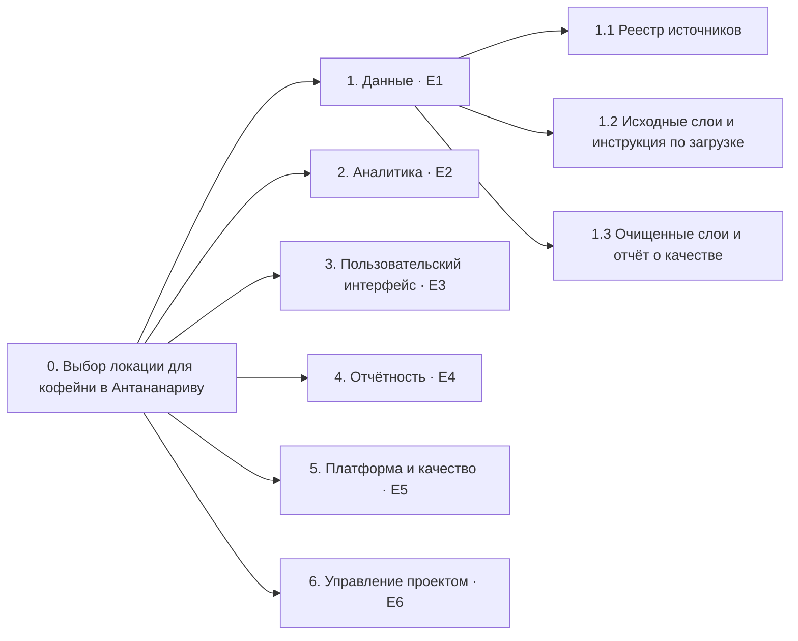

# Иерархическая структура работ (WBS)

## Диаграмма

## Словарь WBS

| Код | Пакет работ | Результат | Критерий готовности | Ответственный | Оценка, ч | Эпик / Issues |
|---|---|---|---|---|---|---|
| 1.1 | Реестр источников | `data/sources.md` | Описаны минимум три источника, из них два пространственных. Указаны лицензии, CRS, актуальность и оценки качества. Каждый аналитический вопрос связан с источниками. | Роман | Уточнить | E1, [#33](https://github.com/DedNadif/pm-lab-01-geomarket/issues/33) |
| 1.2 | Исходные слои и инструкция по загрузке | Слои в `data/raw/` и инструкция в `data/README.md` | Другой участник повторил загрузку по инструкции. Сырые данные не добавлены в Git. | Азат | Уточнить | E1, [#34](https://github.com/DedNadif/pm-lab-01-geomarket/issues/34) |
| 1.3 | Очищенные слои и отчёт о качестве | Слои в `data/processed/` и отчёт `docs/data-quality.md` | Все слои проверены, правила очистки описаны, минимум три проблемы с данными заведены как задачи. | Роман | Уточнить | E1, [#35](https://github.com/DedNadif/pm-lab-01-geomarket/issues/35) |
