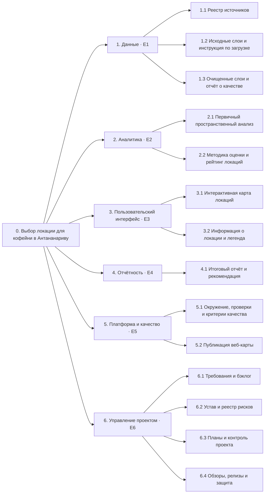

# Иерархическая структура работ (WBS)

## Диаграмма

## Словарь WBS

Оценки трудоёмкости предварительные и указаны в человеко-часах.

| Код | Пакет работ | Результат | Критерий готовности | Ответственный | Оценка, ч | Эпик / Issues |
|---|---|---|---|---|---|---|
| 1.1 | Реестр источников | `data/sources.md` | Описаны минимум три источника, из них два пространственных. Указаны лицензии, CRS, актуальность и оценки качества. Каждый аналитический вопрос связан с источниками. | Роман | 8 | E1, [#33](https://github.com/DedNadif/pm-lab-01-geomarket/issues/33) |
| 1.2 | Исходные слои и инструкция по загрузке | Слои в `data/raw/` и инструкция в `data/README.md` | Другой участник повторил загрузку по инструкции. Сырые данные не добавлены в Git. | Азат | 8 | E1, [#34](https://github.com/DedNadif/pm-lab-01-geomarket/issues/34) |
| 1.3 | Очищенные слои и отчёт о качестве | Слои в `data/processed/` и отчёт `docs/data-quality.md` | Все слои проверены, правила очистки описаны, минимум три проблемы с данными заведены как задачи. | Роман | 12 | E1, [#35](https://github.com/DedNadif/pm-lab-01-geomarket/issues/35) |
| 2.1 | Первичный пространственный анализ | Ноутбук `notebooks/03_spatial_analysis.ipynb`, статичная и интерактивная карты | Есть ответы минимум на два аналитических вопроса. Расстояния рассчитаны в метрической системе координат, выводы записаны в ноутбуке. | Азат | 8 | E2, [#36](https://github.com/DedNadif/pm-lab-01-geomarket/issues/36) |
| 2.2 | Методика оценки и рейтинг локаций | Методика расчёта, таблица показателей и рейтинг локаций | Оценены минимум 10 локаций, рассмотрены два сценария изменения весов. Другой участник дважды воспроизвёл расчёт. | Азат | 16 | E2, [#41](https://github.com/DedNadif/pm-lab-01-geomarket/issues/41), [#48](https://github.com/DedNadif/pm-lab-01-geomarket/issues/48) |
| 3.1 | Интерактивная карта локаций | Веб-карта кандидатных локаций и конкурентов | На карте показаны минимум 10 кандидатных локаций и доступные данные о конкурентах. Карту можно перемещать и масштабировать. | Рафаэль | 16 | E3, [#42](https://github.com/DedNadif/pm-lab-01-geomarket/issues/42), [#49](https://github.com/DedNadif/pm-lab-01-geomarket/issues/49) |
| 3.2 | Информация о локации и легенда | Карточка выбранной локации, легенда и сведения об источниках | При выборе точки видны её идентификатор, оценка и количество конкурентов. На карте указаны источники, ограничения данных и авторство OpenStreetMap. | Рафаэль | 8 | E3, [#42](https://github.com/DedNadif/pm-lab-01-geomarket/issues/42), [#49](https://github.com/DedNadif/pm-lab-01-geomarket/issues/49) |
| 4.1 | Итоговый отчёт и рекомендация | Отчёт для заказчика с обоснованием выбора локации | Представлено сравнение минимум 10 локаций, указаны рекомендуемая точка и её балл, источники и ограничения. Показаны результаты двух сценариев изменения весов с объяснением различий. | Рафаэль | 8 | E4, [#43](https://github.com/DedNadif/pm-lab-01-geomarket/issues/43), [#50](https://github.com/DedNadif/pm-lab-01-geomarket/issues/50) |
| 5.1 | Окружение, проверки и критерии качества | Инструкция по настройке окружения, автоматические проверки, `docs/definition-of-done.md` и шаблон PR | Окружение можно подготовить по инструкции, автопроверки проходят. Пункты DoR и DoD проверяемы, есть критерии для задач с данными, DoD отражён в шаблоне PR. | Дмитрий | 12 | E5, [#44](https://github.com/DedNadif/pm-lab-01-geomarket/issues/44), [#32](https://github.com/DedNadif/pm-lab-01-geomarket/issues/32) |
| 5.2 | Публикация веб-карты | Опубликованная веб-карта с доступом по ссылке | Карта открывается в Chrome и Firefox без установки дополнительных программ. При выборе локации видны сведения о ней и её оценка. | Дмитрий | 8 | E5, [#44](https://github.com/DedNadif/pm-lab-01-geomarket/issues/44), [#51](https://github.com/DedNadif/pm-lab-01-geomarket/issues/51) |
| 6.1 | Требования и бэклог | `docs/requirements.md`, эпики, пользовательские истории и карта историй | Требования описаны, истории привязаны к эпикам, приоритеты указаны, граница MVP обоснована. | Рафаэль | 8 | E6, [#27](https://github.com/DedNadif/pm-lab-01-geomarket/issues/27), [#29](https://github.com/DedNadif/pm-lab-01-geomarket/issues/29), [#30](https://github.com/DedNadif/pm-lab-01-geomarket/issues/30) |
| 6.2 | Устав и реестр рисков | Обновлённые устав проекта и реестр рисков | По результатам работы с данными риски пересмотрены, изменения в уставе внесены через PR. | Роман | 8 | E6, [#37](https://github.com/DedNadif/pm-lab-01-geomarket/issues/37) |
| 6.3 | Планы и контроль проекта | WBS, календарный план, бюджет, план коммуникаций и доска проекта | WBS заполнена, планы подготовлены, задачи и этапы отражены на доске. | Дмитрий | 16 | E6, [#31](https://github.com/DedNadif/pm-lab-01-geomarket/issues/31), [#45](https://github.com/DedNadif/pm-lab-01-geomarket/issues/45) |
| 6.4 | Обзоры, релизы и защита | Протоколы обзоров, релизы и материалы защиты | Проведён обзор ЛР 2, записан протокол, замечания заведены задачами, создан релиз. Итоговые результаты представлены на защите и приняты заказчиком или спонсором. | Дмитрий | 8 | E6, [#38](https://github.com/DedNadif/pm-lab-01-geomarket/issues/38), [#45](https://github.com/DedNadif/pm-lab-01-geomarket/issues/45) |
